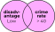

```{r setup, purl=FALSE}
#| include: false
options(width = 68)
knitr::opts_chunk$set(eval=TRUE, echo=TRUE, message=TRUE, warning=TRUE, dev = "svg")
```


## Today {.dark-slide}

* News items:
   * Two *formative* assessments
      * *Light* data analysis and interpretation
      * Due Friday 11:59 PM the following week
   * Reminder: Office hours

* Topics for today:

   * Pipes 
   * Subsetting with `{dplyr}`
   * Creating and modifying variables
   * Distributions
      * Tabulations and Cross-Tabulations
      * Summarizing data
      * Correlations


# `{tidyverse}`

&nbsp;


## Installing `{tidyverse}`

&nbsp;

We're going to practice loading files and manipulating data.

. . .

We will use a packages called `{readr}` and `{dplyr}` to do this neatly.

These packages are part of the [Tidyverse](http://tidyverse.org/) family of R packages

* These packages make using R *much easier*

. . .

If you have not already installed the tidyverse, type, in the console: `install.packages("tidyverse")`

. . .

&nbsp;


This will install a *large* number of R packages we will use throughout the term, including `{readr}`, `{ggplot2}`, and `{dplyr}`.


## Loading packages

&nbsp;

```{r}
library(readr)
library(ggplot2)
library(dplyr)
```


## Wait, was that an error?

&nbsp;


When you load packages in R that have functions sharing the same name as functions you already have, the more recently loaded functions overwrite the previous ones ("masks them").

. . .

This **message** is just letting you know that.

. . .

&nbsp;

Sometimes you may get a **warning message** when loading packages—usually because you aren't running the latest version of R:

```
Warning message:
package `dplyr' was built under R version 4.6.0
```

*Update R* to get rid of these!


# Importing and exporting data

&nbsp;


## Delimited text files

Data are commonly stored in a *delimited* text files, e.g. comma-separated values (**.csv**) or tab-separated values (**.tsv**). Here is **.csv** data:

```
"Id","Offense","Sex","Month"
101,"Battery","Male",1,
101,"Battery","Male",1,
101,"Robbery","Male",1,
101,"Battery","Male",2,
101,"Robbery","Male",2,
101,"Homicide","Male",3,
103,"Robbery","Female",1,
103,"Robbery","Female",3,
103,"Battery","Female",4,
```

Values are *comma-separated* and observations are separated by line breaks


## `{readr}`

R has a variety of built-in functions for importing delimited text, like `read.table()` and `read.csv()`.

&nbsp;

I recommend using the versions in the `{readr}` package instead: `read_csv()`, `read_tsv()`, and `read_delim()`.

&nbsp;

`{readr}` function features:

* Faster---with loading bars for large files
* Smarter about dates and times
* Handy function `problems()` you can run if there are errors


## `{readr}` importing example

&nbsp;

Let's use `read_csv()` from `{readr}` to import some community crime data based on those in yesterday's CRM lecture

```{r}
communities <- 
  read_csv(
    "https://clanfear.github.io/ioc_iqa/_data/communities.csv"
    )
```


# `{dplyr}`

&nbsp;


## A `glimpse()` of `communities`

&nbsp;

`{dplyr}` gives us access to the handy `glimpse()` for inspecting dataframes.


```{r}
glimpse(communities)
```

&nbsp;

This is like a slightly fancier `str()`

## Pipes!

&nbsp;

`{dplyr}` and rest of the Tidyverse are built around using pipe operators (`|>`)

Instead of nesting functions like this:

```{r}
proportions(table(communities$disadvantage))
```

. . .

We can pipe them like this:

```{r}
communities |> pull(disadvantage) |> table() |> proportions()
```

. . .

Read this as, "take `communities`, and then pull out the `incarceration` column, and then make a `table()`, and then calculate `proportions()`."


## `filter()` data frames

&nbsp;

```{r}
communities |> filter(incarceration == "High") |> head()
```

&nbsp;

::: {.center}

*What is this doing?*

:::

&nbsp;

. . .

`filter()` is a `{dplyr}` function for indexing dataframe **rows**

. . .

It takes *only* logical vectors (the result of **expressions**) as an argument


## Multiple conditions

&nbsp;

::::: {.columns}

:::: {.column}

**And**: `&`

```{r, eval=FALSE}
communities |>
  filter(disadvantage == "Low" & 
         crime_rate > 40)
```

{.nostretch width="80%"}

::::

:::: {.column}

::: {.fragment}

**Or**: `|`

```{r, eval=FALSE}
communities |>
  filter(disadvantage == "Low" | 
         crime_rate > 40)
```


{.nostretch width="80%"}

:::

::::

:::::


## `%in%` operator

Common use case: Filter rows to things in some set.

We can use `%in%` like `==` but for matching any element in a vector

```{r}
communities |>
  filter(disadvantage %in% c("High", "Low")) |>
  tail()
```

Read as: "`filter()` to rows where `disadvantage` is `"High"` or `"Low"`"


## Sorting: `arrange()`

&nbsp;

Along with filtering the data to see certain rows, we might want to sort it:

```{r}
communities |>
  arrange(disadvantage, desc(crime_rate)) |> 
  head()
```

The data are sorted by ascending `disadvantage` and descending `crime_rate`.


## Keeping columns: `select()`

&nbsp;

Not only can we subset rows, but we can include specific columns (and put them in the order listed) using `select()`

```{r}
communities |> select(area, pop_density, crime_rate) |> head()
```


## Dropping columns: `select()`

&nbsp;

We can instead drop only specific columns with select() using - signs:

```{r}
communities |> select(-area, -pop_density, -crime_rate) |> head()
```


## Renaming with `select()`

&nbsp;

We can rename columns using `select()`, but that drops everything that isn't mentioned:

```{r}
communities |> select(Area = area) |> head()
```


## Safer: rename with `rename()`

&nbsp;

`rename()` renames variables using the same syntax as `select()` without dropping unmentioned variables

```{r}
communities |> rename(Area = area) |> head()
```


## Creating columns

&nbsp;

`disadvantage` looks like an ordinal variable (`incarceration` too) but R doesn't know this—it just puts them in alphabetical order

```{r}
communities |> pull(disadvantage) |> table()
```

. . .

To fix this, we need to know how to create or modify variables in our data

## Creating columns

&nbsp;

`dplyr` uses the `mutate()` function to create or modify variables:

```{r}
communities |>
  mutate(high_crime = crime_rate > mean(crime_rate)) |>
  head()
```

This created a **logical** (`TRUE`/`FALSE`) variable because we used a logical expression


## Modifying columns

In R, we "modify" objects—including columns in our data—by replacing them with new versions

. . .

We saw before that our disadvantage and incarceration variables are ordinal but not being recognized that way

. . .

We can give them an order by making them **factors** and specifying their **levels**

```{r}
communities <- communities |>  # Assigning back to overwrite!
  mutate(disadvantage = 
           factor(disadvantage, levels = c("Low", "Medium", "High")),
         incarceration = 
           factor(incarceration, levels = c("Low", "Medium", "High"))
         )
```

To modify the original dataset, we just assign back to it—overwriting it with our changes!


## Fixed!

&nbsp;

```{r}
communities |> pull(disadvantage) |> table()
```


```{r}
communities |> pull(incarceration) |> table()
```


## Distributions {.dark-slide}

&nbsp;

### Numbers today (boo!)

&nbsp;

### Pictures next week (fun!)


## Tabulations

Let's look at tabulations first. They're useful for summarizing categorical data.

. . .

`count()` is a `{dplyr}` function for tabulating one or more columns

```{r}
communities |> count(incarceration)
```

I creates a new column, `n` with the count of each level

. . .

```{r}
communities |> count(incarceration) |> mutate(proportion = n/sum(n))
```


## `{janitor}`

`{janitor}` is a data cleaning package, but it makes tabulations easier too

```{r, eval = FALSE}
install.packages("janitor")
```

```{r}
library(janitor)
```


&nbsp;

```{r}
communities |> tabyl(incarceration)
```


. . .

&nbsp;

It comes in *really* handy for **cross-tabs**—we'll see them soon!


## `summarize()`

`{dplyr}`'s **`summarize()`** takes your column(s) of data and computes something using *every row*: 

* Calculate the mean (`mean()`)
* Calculate the standard deviation (`sd()`)
* Obtain a sample size (`n()`)

. . .

```{r}
communities |>
  summarize(mean_crime_rate = mean(crime_rate),
            sd_crime_rate   = sd(crime_rate), 
            n               = n())
```

. . .

You can use any function in `summarize()` that aggregates *multiple values* into a *single value* (like `sum()`, `median()`, or `max()`).


# Associations

&nbsp;

Which are really about **joint distributions**


## Cross-tabs

Let's look at cross-tabs first. They're used for associations between categorical variables.

. . .

This is where `{janitor}`'s `tabyl()` begins to shine:

. . .

```{r}
communities |> 
  tabyl(disadvantage, incarceration)
```

. . .

&nbsp;

```{r}
communities |> 
  tabyl(disadvantage, incarceration) |>
  adorn_percentages() # converts to cell percentages 
```


## Fancy cross-tabs

We can assemble *fancy* tables bit-by-bit with `{janitor}`

```{r}
communities |> 
  tabyl(disadvantage, incarceration) # make table
```


## Fancy cross-tabs

Add row and column totals!

```{r}
communities |> 
  tabyl(disadvantage, incarceration) |> # make table
  adorn_totals(c("row", "col")) # add row/col totals
```


## Fancy cross-tabs

Turn cells into (row) percentages instead of counts

```{r}
communities |> 
  tabyl(disadvantage, incarceration) |> # make table
  adorn_totals(c("row", "col")) |> # add row/col totals
  adorn_percentages()# make cells proportions
```


## Fancy cross-tabs

Round those percentages to two decimal places!

```{r}
communities |> 
  tabyl(disadvantage, incarceration) |> # make table
  adorn_totals(c("row", "col")) |> # add row/col totals
  adorn_percentages() |> # make cells percentages
  adorn_pct_formatting(digits = 1) # percents with 1 digit
```


## Fancy cross-tabs

Add counts back in parentheses!

```{r}
communities |> 
  tabyl(disadvantage, incarceration) |> # make table
  adorn_totals(c("row", "col")) |> # add row/col totals
  adorn_percentages() |> # make cells percentages
  adorn_pct_formatting(digits = 1) |> # percents with 1 digit
  adorn_ns() # add counts in parentheses
```


## Fancy cross-tabs

Add column variable name!

```{r}
communities |> 
  tabyl(disadvantage, incarceration) |> # make table
  adorn_totals(c("row", "col")) |> # add row/col totals
  adorn_percentages() |> # make cells percentages
  adorn_pct_formatting(digits = 1) |> # percents with 1 digit
  adorn_ns() |> # add counts in parentheses
  adorn_title() # add col variable name
```

Not bad! That's not far from paper ready!


## Grouped measures

If we wanted to calculated means for different groups, one easy way is to just subset the data

. . .

::::: {.columns}

:::: {.column}

```{r}
communities |>
  filter(disadvantage=="High") |> 
  summarize(
   mean_crime = mean(crime_rate),
   sd_crime   = sd(crime_rate), 
   n          = n())
```


::::

:::: {.column}

```{r}
communities |>
  filter(disadvantage=="Low") |> 
  summarize(
   mean_crime = mean(crime_rate),
   sd_crime   = sd(crime_rate), 
   n          = n())
```

::::

:::::

. . .

Imagine if you had many groups, though! There's a better way.


  
## `group_by()`


The special function `group_by()` changes how functions operate on the data, most importantly `summarize()`.

Functions after `group_by()` are computed *within each group* as defined by variables given, rather than over all rows at once.

Excel analogue: pivot tables


## `group_by()` example

&nbsp;

```{r}
communities |>
  group_by(disadvantage) |> 
  summarize(mean_crime = mean(crime_rate),
            sd_crime   = sd(crime_rate), 
            n          = n())
```

&nbsp;

Because we did `group_by()` with `disadvantage` then used `summarize()`, we get *one row per value of `disadvantage`*!

Each value of disadvantage is its own **group**!


## `.by = ` example

&nbsp;

You can also do grouping within `summarize()` or `mutate()` using `.by = `

```{r}
communities |>
  summarize(mean_crime = mean(crime_rate),
            sd_crime   = sd(crime_rate), 
            n          = n(),
            .by = disadvantage) 
```

&nbsp;

I recommend using this method when possible as it automatically ungroups afterward


## Correlations

Correlations are mathematically complicated but simple to code

```{r}
cor(communities$pop_density, communities$crime_rate)
```

. . .

&nbsp;

Alternatively, you can use the `with()` command for a bit less typing

```{r}
with(communities, cor(pop_density, crime_rate))
```

. . .

&nbsp;

These are a bit easier than `dplyr` if you just want one correlation

```{r}
communities |> summarize(R = cor(pop_density, crime_rate))
```


## Multiple correlations

&nbsp;

If you want to do correlations *within groups*, `{dplyr}` is king again

```{r}
communities |>
  summarize(R = cor(pop_density, crime_rate), .by = disadvantage)
```

In this case, the correlation between `pop_density` and `crime_rate` is similar at all levels of disadvantage


## Correlation matrices

&nbsp;

`cor()` produces correlation matrices when given multiple continuous variables

```{r}
anscombe |> # Anscombe's quartet from yesterday!
  select(x1, y1, y2, y3, y4) |> 
  cor()
```


## Wrap-up {.dark-slide}
  
* Recommended reading for next week
   * Kaplan, chapter 10 is review of today's content
      * Chapter 14 (graphing) is what we'll get into next week
   * You're pretty busy, so make it low priority!
* `{swirl}` units if you want practice
   * 5 covers missing values
   * 6 covers subsetting
* Next time:
   * More on relationships
   * Distributions
   * Maybe a start on inference