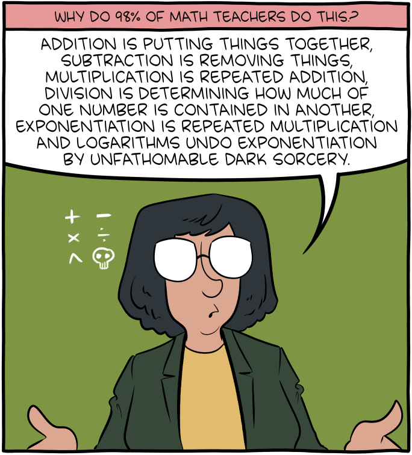

```{r setup, purl=FALSE}
#| include: false
options(width = 68)
set.seed(7)
knitr::opts_chunk$set(eval=TRUE, echo=TRUE, message=FALSE, warning=FALSE, dev = "svg", fig.height = 4)
```


## Today {.dark-slide}

&nbsp;

Joining data

Logarithms

Moderation


## Loading data

```{r}
library(tidyverse)
library(broom)
library(janitor)
```


Often you have multiple sources of data that you want to use together

```{r}
metro_2021_crime    <- 
  read_csv("https://clanfear.github.io/ioc_iqa/_data/metro_2021_crime.csv")
borough_deprivation <- 
  read_csv("https://clanfear.github.io/ioc_iqa/_data/borough_deprivation.csv")
borough_pop_density <- 
  read_csv("https://clanfear.github.io/ioc_iqa/_data/borough_pop_density.csv")
london_subregion    <- 
  read_csv("https://clanfear.github.io/ioc_iqa/_data/london_subregion.csv")
```


## Taking a look

```{r, purl=FALSE, include = FALSE}
options(width = 40)
```


::::: {.columns}

:::: {.column width="50%"}

```{r}
names(metro_2021_crime)
names(london_subregion)
names(borough_pop_density)
names(borough_deprivation)
```

::::

:::: {.column width="50%"}

```{r}
dim(metro_2021_crime)
```

<p style="margin-bottom:2.25cm;">&nbsp;</p>

```{r}
dim(london_subregion)
dim(borough_pop_density)
dim(borough_deprivation)
```

::::

:::::


```{r, purl=FALSE, include = FALSE}
options(width = 68)
```


## Joining concepts

We can **join** data frames using functions from `{dplyr}` (part of `{tidyverse}`)

. . .

Before we use them, we need to think about how we want to join the data frames:

:::: {.incremental}

* Which rows are we keeping from each data frame?

* Which columns are we keeping from each data frame?

* Which variables determine whether rows match?

::::


## Types of join

Given two dataframes, `df_a` and `df_b`, there are *many* ways to join them

. . .

The most commonly used:

* **Left Join**: `df_a |> left_join(df_b)`

   * Keep all columns and rows from `df_a`
   * Keep all columns but only rows that match from `df_b`

. . .

* **Inner Join**: `df_a |> inner_join(df_b)`

   * Keep all columns but only rows that match from `df_a`
   * Keep all columns but only rows that match from `df_b`

. . .

* **Full Join**: `df_a |> full_join(df_b)`

   * Keep all columns and rows from `df_a`
   * Keep all columns and rows from `df_b`


## Same names

If the joined data frames share some column names, they will automatically match on those columns

```{r}
metro_2021_crime |>
  left_join(london_subregion) |> 
  glimpse()
```

. . .

&nbsp;

While it does not occur here, if joined columns have no data for a given row (e.g., in full or left joins), `NA` values will be created

## Differing names

`borough_pop_density` has a different naming style (title case)

If matching variable names differ, you can specify what left side variable (`"borough"`) matches the right side variable (`"Borough"`)

```{r}
metro_2021_crime |>
  left_join(borough_pop_density, by = c("borough"="Borough")) |>
  glimpse()
```


. . .

It is better, usually, to just fix the names before joining though!


## Many joins, handle it

We can chain many joins in order—and here we `clean_names()` to fix the capitalized names ahead of time

```{r}
metro_2021 <- metro_2021_crime |>
  left_join(london_subregion) |>
  left_join(borough_deprivation) |>
  left_join(borough_pop_density |> clean_names())
head(metro_2021, 3)
```


## Some clean-up

Let's do a little bit of data management while we're at it

```{r, message = FALSE, warning = FALSE}

metro_2021 <- metro_2021 |>
  rename(violence = violence_and_sexual_offences,
         asb      = antisocial_behaviour) |>
  mutate(month    = lubridate::month(month),
         pop_den = (pop/1000)/area)
```

Things done:

* Shorten a couple names for ease of use
* Convert `month` to an integer using `{lubridate}`<sup>1</sup>
* Create a population density (`pop_den`) in thousands per $km^2$

::: {.foot}

[1] `{lubridate}` is a *great* package for working with dates and times

:::


## Model from last time

We created a curve with a **quadratic** functional form of `month`

::::: {.columns}

:::: {.column width="50%"}

```{r}
lm_sq <- 
  lm(violence ~ month + I(month^2), 
   data = metro_2021) 
lm_sq |> tidy() |> 
  select(term, estimate, std.error)
```

::::

:::: {.column width="50%"}

```{r, echo=FALSE}
#| fig.height: 4.25
ggplot(metro_2021, aes(x = month, y = violence)) + 
  geom_point() + 
  geom_smooth(method = "lm", 
              formula = y ~ x + I(x^2))
```

::::

:::::


. . .

This fits our data well, but has drawbacks:

* Uses two parameters
* Complicated interpretation

. . .

::: {.center}

*There are simpler—more restrictive—curves we can fit*

:::


# Logarithms




## One parameter curve

`log()` provides an alternative single parameter curve

::::: {.columns}

:::: {.column width="50%"}

```{r}
lm_log <- lm(violence ~ log(month), 
   data = metro_2021)
lm_log |> tidy() |> 
  select(term, estimate, std.error)
```

::::

:::: {.column width="50%"}

```{r, echo=FALSE}
#| fig.height: 4.25
ggplot(metro_2021, aes(x = month, y = violence)) + 
  geom_point() + 
  geom_smooth(method = "lm", 
              formula = y ~ log(x))
```

::::

:::::


. . .

In this case, it doesn't look like a great fit

* These models are not **nested** so they cannot be compared with `anova()`
* *We'll see a tool to compare these shortly*

. . .

::: {.center}

*But first, what is `log()` anyway?*

:::


## Quick maths

Exponentiation, ${\color{#00BDB6}{b}}^{{\color{#DD3025}{n}}} = {\color{#FD8153}{x}}$, multiplies a number (the **base**, ${\color{#00BDB6}{b}}$) by itself ${\color{#DD3025}{n}}$ times:

$${\color{#00BDB6}{5}}^{{\color{#DD3025}{2}}} = {\color{#00BDB6}{5}} \times {\color{#00BDB6}{5}} = {\color{#FD8153}{25}}$$

. . .

Roots, $\sqrt[{\color{#DD3025}{n}}]{{\color{#FD8153}{x}}} = {\color{#00BDB6}{b}}$, give the base you'd need to raise to power ${\color{#DD3025}{n}}$ to get ${\color{#FD8153}{x}}$:

$$\sqrt[{\color{#DD3025}{2}}]{{\color{#FD8153}{25}}} = {\color{#FD8153}{25}} / {\color{#00BDB6}{5}} = {\color{#00BDB6}{5}}$$

. . .

Logarithms, $\log_{{\color{#00BDB6}{b}}}({\color{#FD8153}{x}}) = {\color{#DD3025}{n}}$, give the ${\color{#DD3025}{n}}$ to which you raise ${\color{#00BDB6}{b}}$ to get ${\color{#FD8153}{x}}$:

$$\log_{{\color{#00BDB6}{5}}}({\color{#FD8153}{25}}) = {\color{#DD3025}{2}}$$

::: {.center}

*To get 25, you raise 5 (the base) to the power of 2*

:::


## The natural log

In statistics and maths, we often use *Euler's number* (~2.718), $e$, as a base

* $log_{e}(x)$ is the **natural logarithm** and $e^n$ is the **exponential function**

. . .

* `log(x)` is $log_{e}(x)$ or $ln(x)$ and `exp(n)` is $e^n$

. . .

* `log(exp(x))` and `exp(log(x))` are both equal to `x`!


## Natural logs

::::: {.columns}

:::: {.column width="50%"}

```{r}
exp(1:3)
curve(exp(x), from = 1, to = 3)
```

::::

:::: {.column width="50%" .fragment}

```{r}
log(1:3)
curve(log(x), from = 1, to = 3)
```

::::

:::::


. . .

These are useful because they produce *curves* with simple derivatives:

$$\frac{d}{dx}e^x = e^x\quad\quad\quad\quad \frac{d}{dx}log_e(x) = \frac{1}{x}$$

$e^x$ is its own derivative even!


## `log(x)` interpretation

```{r}
lm_log |> coef()
```

Natural logs allow for a special interpretation called an **elasticity** or **partial elasticity**

. . .

When only an independent variable is logged, we call it a **level-log** (*partial elasticity*) model:

* Divide the $x$ coefficient by 100 and it is the amount $y$ differs due to a $1\%$ difference in $x$<sup>1</sup>

* A $1\%$ increase in `month`<sup>2</sup> is associated with .64 more `violence`

::: {.foot}

[1] More precisely: $p\%$ higher $x$ is associated with $b * log(1 + \frac{p}{100})$ higher $y$

:::


## `log(y)` interpretation

```{r}
lm(log(violence) ~ month, 
   data = metro_2021) |> coef()
```

You can also log the *outcome*

. . .

When only the dependent variable is logged, we call it a **log-level** (*partial elasticity*) model:

* Multiply $x$ coefficient by 100 and it is the percent $y$ differs due to a difference in $x$<sup>1</sup>

* An increase of 1 in `month` is associated with $1.7\%$ higher `violence`

::: {.foot}

[1] This is approximate; the exact version is a $(e^{b}-1)*100\%$ difference in $y$

:::


## Log-log models

```{r}
lm(log(violence) ~ log(month), 
   data = metro_2021) |> coef()
```

If we log both $x$ and $y$ we get a **log-log** (*elasticity*) model

. . .

When both $x$ and $y$ are logged:

* The $x$ coefficient is the percent $y$ differs due to a percent difference in $x$

* A $1\%$ increase in `month` is associated with a $0.11\%$ increase in `violence`


## Working with logs

:::::: {style="font-size: 80%;"}

::::: {.columns}

:::: {.column width="50%"}

By compressing higher values, they reduce *skew*

* This tends to reduce **heteroskedasticity**
   * **Heteroskedasticity** is variance that differs across model predictions
   * It only impacts standard errors in standard linear models<sup>1</sup>
   * Correct with robust errors, functional form, or alternate estimators
* Makes some models easier to estimate

::::

:::: {.column width="50%"}

::: {.fragment fragment-index=1}

Some warnings: 

* You can only take a log of a positive (non-zero) number!
   * *Don't just add 1 then log it!*<sup>2</sup>
* The curve is *inflexible*
* The percentage interpretation is an *approximation*
   * Inaccurate for changes in $x$ much smaller or greater than $1$

:::

::::

:::::

::::::


::: {.foot}

[1] It causes serious problems in many other types of models<br>
[[2] See [Chen & Roth (2024) Logs with zeros? Some problems and solutions](https://doi.org/10.1093/qje/qjad054)]{.fragment fragment-index=1}

:::


# Moderation


Using interaction terms

&nbsp;

> Moderation in all things is best, but it's pretty hard to get excited about it. — Mason Cooley


## Moderation

**Moderation** occurs when the association between $x$ and $y$ is different across values of another variable $z$ 

. . .

This implies a **multiplicative** relationship rather than just an **additive** one

* **Additive**: $y = b_1x + b_2z$
* **Multiplicative**: $y = b_1x + b_2z + b_3\color{#DD3025}{xz}$

. . .

Note that we obey **hierarchy**: Include $x$ and $z$ alone when using $x*z$<sup>1</sup>

::: {.foot}

[1] There are *rare* cases when you drop one or both first order terms

:::

. . .

## Moderation and DAGs

&nbsp;

::::: {.columns}

:::: {.column width="50%"}

Moderation is not indicated by DAGs<sup>1</sup>

Moderation is a type of *functional form* like polynomials or logarithms

::::

:::: {.column width="50%"}

```{tikz mod-dag, fig.width = 2.75, cache = TRUE, purl = FALSE, echo = FALSE}
\usetikzlibrary{positioning}
\definecolor{black}{HTML}{000000}
\tikzset{
    > = stealth,
    every node/.append style = {
        draw = none,
        scale = 3
    },
    every path/.append style = {
        arrows = ->,
        draw = black,
        fill = none,
        scale = 1,
        line width = 1.5mm
    },
    hidden/.style = {
        draw = black,
        shape = circle,
        inner sep = 1pt
    }
}
\tikz{
  \node (Y) at (0, 1.25) {$Y$};
  \node (Z) at (5, 0) {$Z$};
  \node (X) at (5, 2.5) {$X$};
  \path (X) edge (Y);
  \path (Z) edge (Y);
  }
```

::::

:::::

&nbsp;

Arrows pointing to other arrows are sometimes used in path diagrams (e.g., for SEM) to indicate moderation but *not* DAGs


## Visual moderation

Moderation produces *different slopes* for $x$ at each value of $z$

. . .

For categorical $z$, this may be seen with a regression line for each level of $z$

::::: {.columns}

:::: {.column width="50%"}

```{r int-plot, fig.show='hide'}
ggplot(metro_2021 , 
    aes(x     = pop_den, 
        y     = violence, 
        color = deprivation)) + 
  geom_point() + 
  geom_smooth(method = "lm")
```

::::

:::: {.column width="50%"}

`)

::::

:::::


. . .

`pop_den` has a negative slope only for "medium" `deprivation` boroughs

* *Crime is lower when population density is higher in boroughs with moderate deprivation*
* *Crime is higher when population density is higher in boroughs with low or high deprivation*


## Moderation formula

We can fit a model with moderation by *multiplying variables* in the formula

```{r}
lm_int <- lm(violence ~ deprivation*pop_den, data = metro_2021)
lm_int |> tidy() |> select(term, estimate, statistic)
```

. . .

By default, it will obey **hierarchy** and include the first-order terms


## Interpretation

Interactions need to be interpreted using (partial) derivatives like polynomials

$$y = 632 -205*depLow + 318*depMed + 6.4*popDen + \\
4.0*depLow*popDen - 37*depMed*popDen$$

. . .

The estimated effect of `pop_den` is the *partial derivative*:

$$\beta_{dpopDen} = \frac{dviolence}{dpopDen} = 6.4 + 4*depLow -37*depMed$$

. . .

We can calculate the effect of `pop_den` when `deprivation` is... 

\begin{align}
\text{Low: } & \beta_{dpopDen} = 6.4 + 4*1 -37*0 =\hphantom{-} 10.4\\
\text{Moderate: } & \beta_{dpopDen} = 6.4 + 4*0 -37*1 = -30.6\\
\text{High: } & \beta_{dpopDen} = 6.4 + 4*0 -37*0 =\hphantom{-} 6.4
\end{align}


## Specification test

You can test if an interaction is warranted, because the **additive** model is nested inside the interaction model:

```{r}
lm_noint <- lm(violence ~ deprivation + pop_den, data = metro_2021)
anova(lm_int, lm_noint)
```


## Fitted values

::::: {.columns}

:::: {.column width="50%"}

```{r int-fitted, fig.show='hide'}
lm_int |>
  augment() |>
  ggplot(
    aes(x = pop_den, 
        y = .fitted, 
        color = deprivation)) +
  geom_point() +
  geom_line()
```

::::

:::: {.column width="50%"}

`)

::::

:::::


&nbsp;

The fitted values are still all along lines...

... but there's a different line for each level of `deprivation`!


## Wrap-up {.dark-slide}

* That was the last new content of the term!

* No reading

* Last assignment

   * Posted soon
